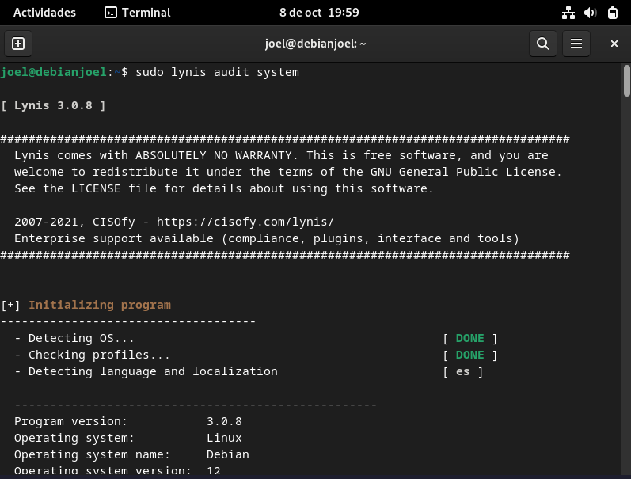
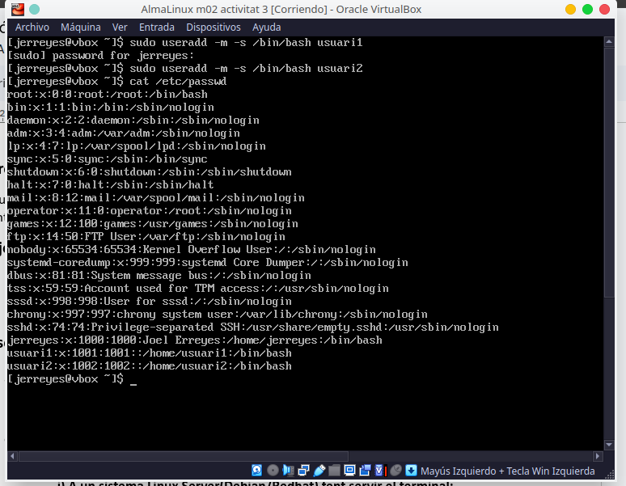
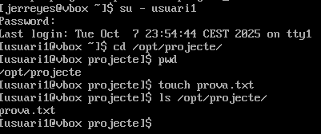
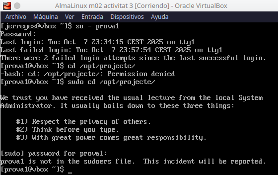
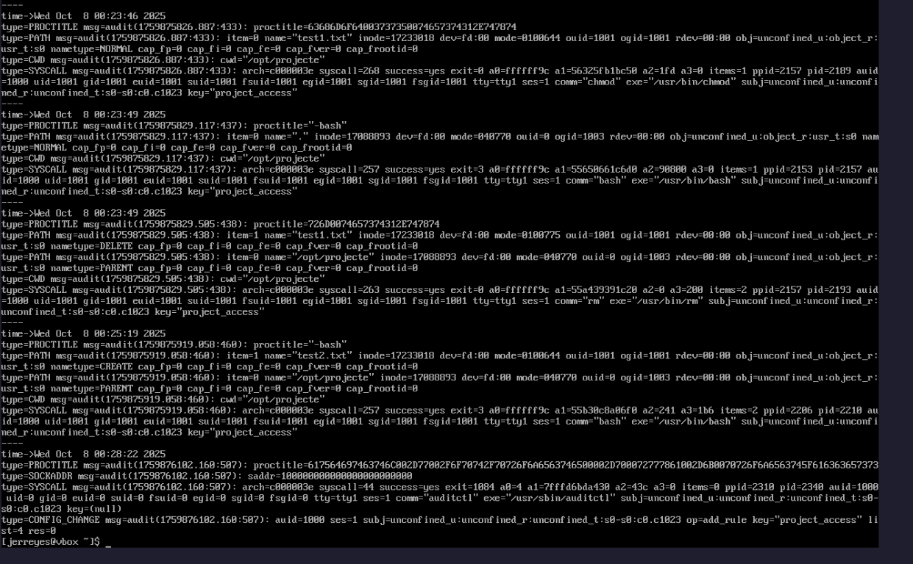
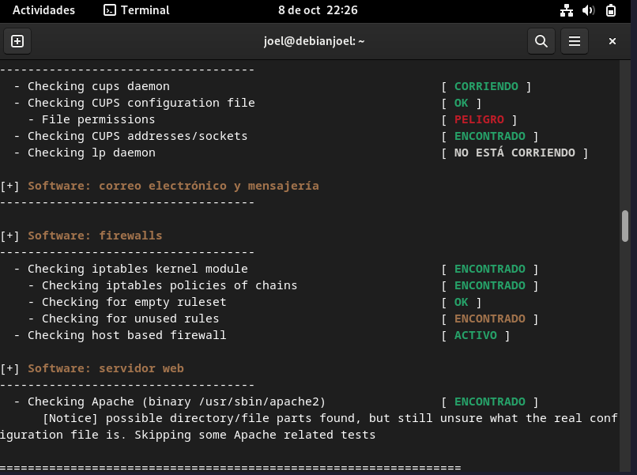

# Linux Evidence

This folder contains the evidence collected for the Linux lab. The procedure and the separation between AlmaLinux Minimal and Debian 12 are explained in [`linux/README.md`](../README.md).

## Included Evidence

The following screenshots were provided for this lab. The first pieces of evidence mainly correspond to AlmaLinux, while evidence E01 corresponds to Debian 12. Therefore, they should not be presented as if they were part of a single execution on the same system.

### E01 — Debian 12 Environment and Lynis

The screenshot confirms that Lynis detects Debian 12 and serves as evidence of the environment and the beginning of the security audit.

### E02 — Linux Users

The screenshot shows `usuari1` and `usuari2` created with their home directories and `/bin/bash` as their login shell.

### E03 — Password Expiration

`chage` shows a maximum password age of 90 days and a warning 7 days before expiration.

### E04 — Protected Directory

The test shows that direct access to `/opt/projecte` is denied to a user without the required permissions, while the administrator can inspect the directory.

### E05 — Authorized Access

`usuari1`, who belongs to the project group, accesses `/opt/projecte` and creates `prova.txt`.

### E06 — Denied Access

`prova1`, who does not belong to the group and is not listed in `sudoers`, receives `Permission denied`.

### E07 and E08 — Auditing with auditd

The `project_access` rule appears as loaded, and the audit events record access to the directory and files created inside it.

### E09, E10 and E11 — UFW Firewall

These screenshots document an additional hardening step on Debian: UFW installation, the `deny` incoming policy, the `allow` outgoing policy and SSH access configuration.

### E12 — Firewall Review with Lynis

Lynis detects the active firewall and displays checks related to `iptables` and network services.

## Evidence Index

| ID | Evidence | What it shows |
|---|---|---|
| E01 | Environment | Debian 12 detected by Lynis |
| E02 | Users | Linux users created |
| E03 | Policy | Password expiration settings using `chage` |
| E04 | Permissions | Unauthorized access blocked |
| E05 | Allowed access | `usuari1` accessing the directory and creating a file |
| E06 | Denied access | External user receiving `Permission denied` |
| E07 | Audit rule | `auditctl -l` displaying `project_access` |
| E08 | Audit event | `auditd` events related to the directory |
| E09-E11 | Firewall | Script, UFW installation and firewall status |
| E12 | Hardening | Lynis detecting the active firewall |