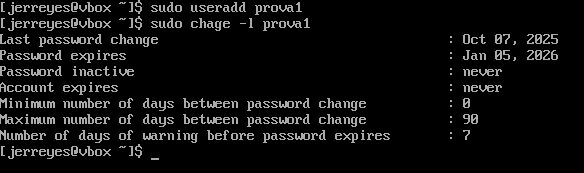
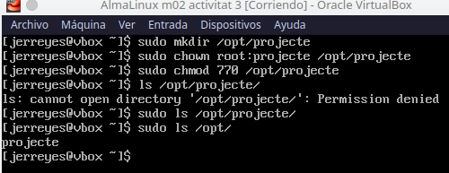
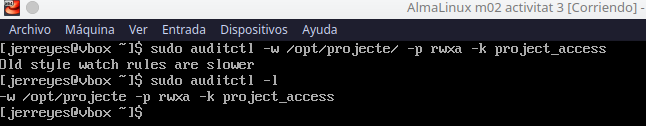
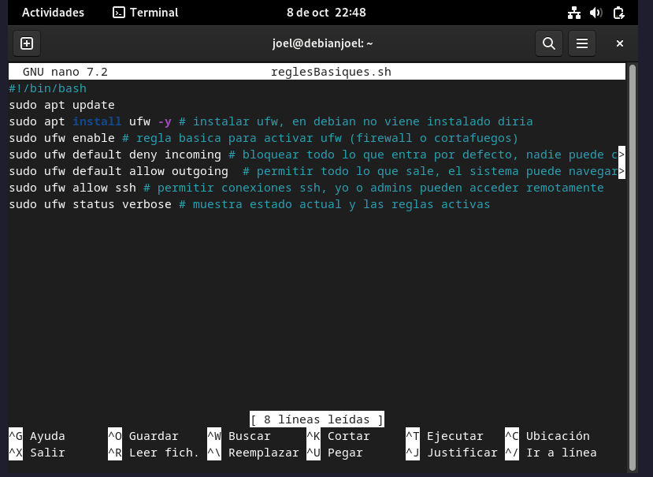
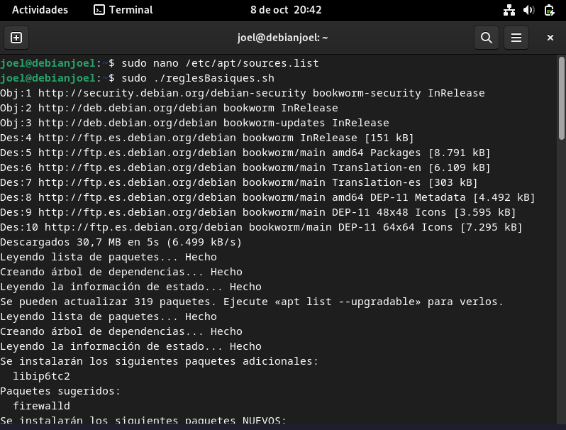
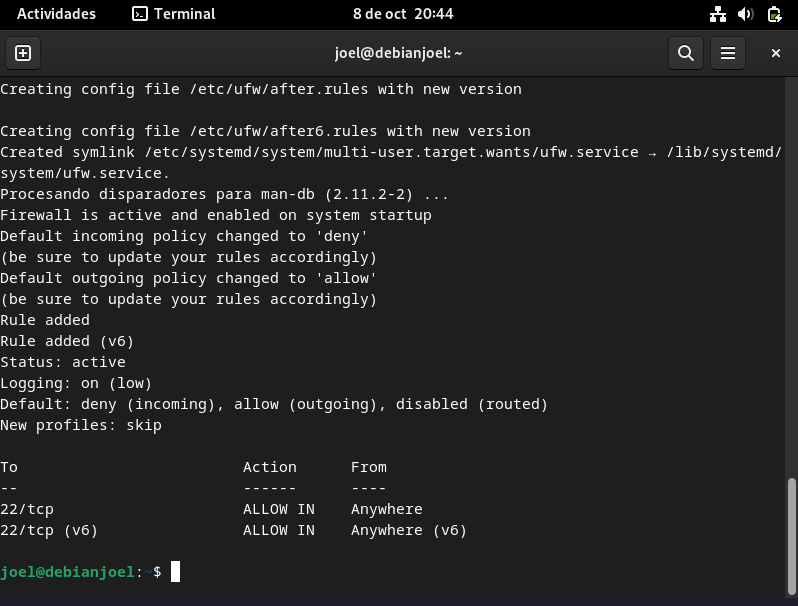

# Evidencias Linux

Esta carpeta contiene las evidencias integradas del laboratorio Linux. El
procedimiento y la separación entre AlmaLinux Minimal y Debian 12 se explican en
[`linux/README.md`](../README.md).

## Evidencias incorporadas

Estas son las capturas aportadas para esta práctica. Las primeras evidencias
corresponden principalmente a AlmaLinux y la evidencia E01 corresponde a Debian
12; por eso no deben presentarse como si fueran una única ejecución sobre el
mismo sistema.

### E01 — Entorno Debian 12 y Lynis

La imagen confirma que Lynis detecta Debian 12 y sirve como evidencia del entorno
y del inicio de la auditoría.

### E02 — Usuarios Linux

Se observan `usuari1` y `usuari2` creados con su directorio personal y shell
`/bin/bash`.

### E03 — Caducidad de contraseña

`chage` muestra una caducidad máxima de 90 días y aviso 7 días antes.

### E04 — Directorio protegido

La prueba muestra que el acceso directo a `/opt/projecte` falla para un usuario
sin permisos, mientras que el administrador puede comprobar el directorio.

### E05 — Acceso autorizado

`usuari1`, que pertenece al grupo del proyecto, entra en `/opt/projecte` y crea
`prova.txt`.

### E06 — Acceso denegado

`prova1`, que no pertenece al grupo y tampoco está en `sudoers`, recibe
`Permission denied`.

### E07 y E08 — Auditoría con auditd

La regla `project_access` aparece cargada y los eventos registran accesos al
directorio y ficheros creados dentro de él.

### E09, E10 y E11 — Firewall UFW

Estas imágenes documentan una ampliación de hardening en Debian: instalación de
UFW, política de entrada `deny`, política de salida `allow` y permiso SSH.

### E12 — Revisión del firewall con Lynis

Lynis detecta el firewall activo y muestra comprobaciones relacionadas con
`iptables` y servicios de red.

## Índice de evidencias

| ID | Evidencia | Qué debe verse |
|---|---|---|
| E01 | Entorno | Debian 12 detectado por Lynis |
| E02 | Usuarios | usuarios Linux creados |
| E03 | Política | caducidad de contraseña con `chage` |
| E04 | Permisos | acceso no autorizado bloqueado |
| E05 | Acceso permitido | `usuari1` entrando y creando un fichero |
| E06 | Acceso denegado | usuario externo recibiendo `Permission denied` |
| E07 | Regla de auditoría | `auditctl -l` mostrando `project_access` |
| E08 | Evento | eventos de `auditd` sobre el directorio |
| E09-E11 | Firewall | script, instalación y estado de UFW |
| E12 | Hardening | Lynis detectando el firewall activo |
