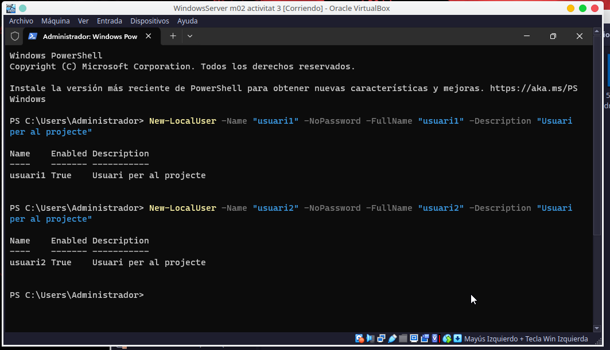
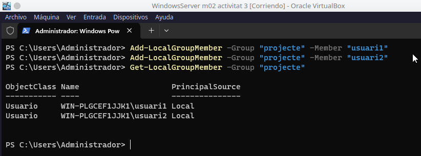
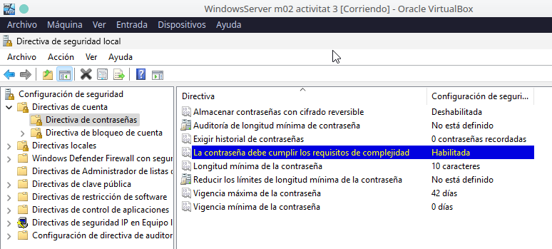
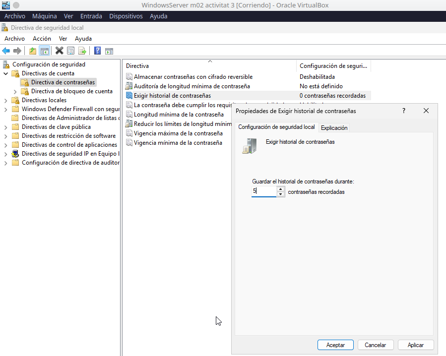
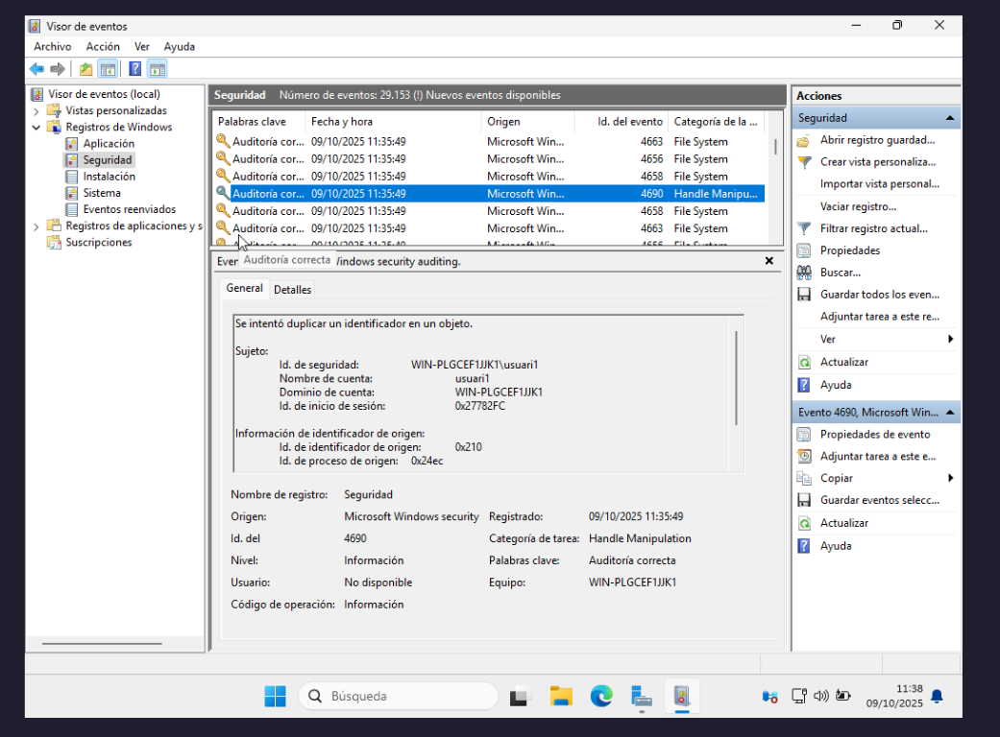

# Windows Server 2025 and Windows 11

This section documents the Windows part of the lab. The work was carried out on a Windows Server 2025 virtual machine, and the procedure is also applicable to Windows 11. It is independent of the AlmaLinux Minimal and Debian 12 labs.

## Configuration Performed

Two local user accounts (`usuari1` and `usuari2`) and the `projecte` group were created using PowerShell. Both users were added to the group:

Password policies were configured through `secpol.msc`, under Account Policies:

- Minimum password length: 10 characters.
- Password complexity requirements enabled.
- Maximum password age: 90 days.
- Password history: last 5 passwords remembered.

NTFS permissions were configured for `C:\Projecte` and the `projecte` group, while preserving system and administrator permissions:

Access auditing was recorded in the Windows Event Viewer. The evidence shows an event associated with the `usuari1` account, with event ID 4690 and the `Handle Manipulation` category:

## Technical Documentation

The complete procedure, including PowerShell commands, `secpol.msc` configuration, NTFS permissions and auditing, is documented in [`windows/lab.md`](lab.md).