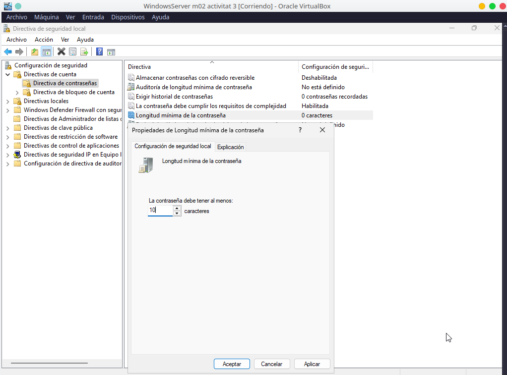
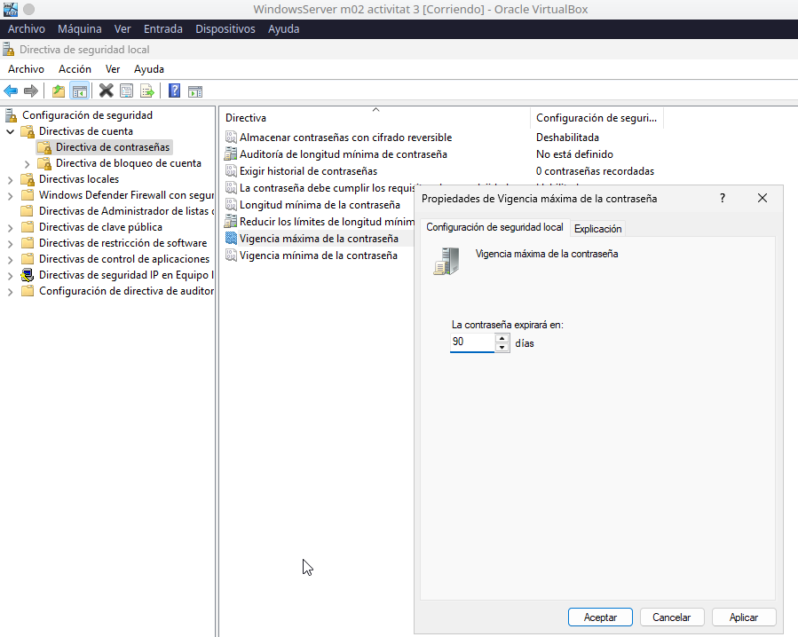
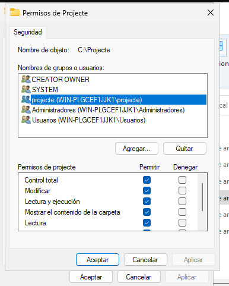

# Windows Server 2025 y Windows 11

Este apartado documenta la parte Windows de la actividad. El trabajo se realizó
en una máquina virtual Windows Server 2025 y el procedimiento es aplicable
también a Windows 11. Es independiente de los laboratorios AlmaLinux Minimal y
Debian 12.

## Configuración realizada

Se crearon dos usuarios locales (`usuari1` y `usuari2`) y el grupo `projecte`
mediante PowerShell. Ambos usuarios se añadieron al grupo:

Desde `secpol.msc`, en las directivas de cuenta, se configuraron las políticas
de contraseñas:

- longitud mínima de 10 caracteres;
- complejidad obligatoria;
- vigencia máxima de 90 días;
- historial de las últimas 5 contraseñas.

Se configuraron los permisos NTFS de `C:\Projecte` para el grupo `projecte`,
manteniendo los permisos del sistema y de los administradores:

La auditoría de accesos quedó registrada en el Visor de eventos de Windows. La
evidencia muestra un evento asociado al usuario `usuari1`, con identificador
4690 y categoría `Handle Manipulation`:

## Documentación técnica

El procedimiento completo, con los comandos PowerShell, la configuración de
`secpol.msc`, los permisos NTFS y la auditoría, está en
[`windows/lab.md`](lab.md).
